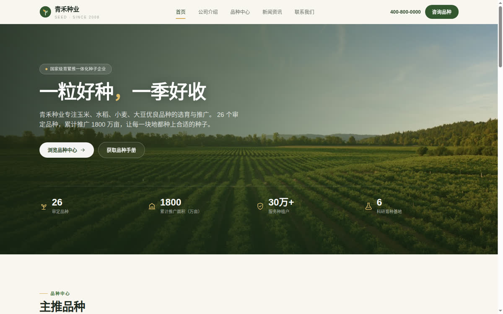
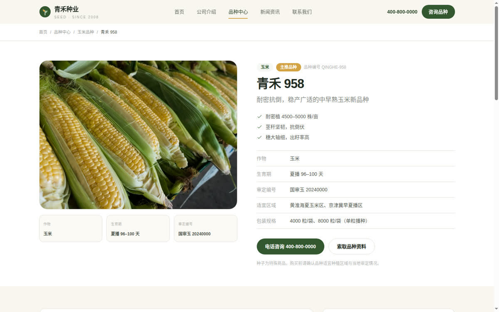
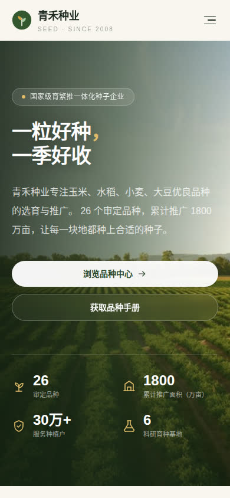

# 青禾种业 · 企业官网

面向种业企业的**品种展示型**官网模板：只做品种/商品展示与品牌介绍，**不含购物车、支付、会员与后台**。
基于 [TencentEdgeOne/enterprise-website-template](https://github.com/TencentEdgeOne/enterprise-website-template)（MIT）的工程结构改造，重写为农业风格的静态站点。

- 技术栈：Next.js 15（`output: "export"` 静态导出）+ Tailwind CSS 3 + TypeScript
- 零后端：构建产物是纯静态文件，可部署到 GitHub Pages / Gitee Pages / OSS / COS / Nginx / 任意 CDN
- 移动端自适应、SEO 友好（语义化标签、canonical、OG、JSON-LD、sitemap、robots）



| 品种详情 | 移动端 |
| --- | --- |
|  |  |

## 页面结构

| 路径 | 说明 |
| --- | --- |
| `/` | 首页：Banner、主推品种、公司介绍、优势、新闻、选种咨询 CTA |
| `/about/` | 公司介绍：简介、数据、价值观、发展历程、组织能力 |
| `/varieties/` | 品种产品列表：作物筛选（玉米/水稻/小麦/大豆）+ 关键词搜索 |
| `/varieties/[slug]/` | 品种详情：特征特性、产量、抗性、栽培要点、同作物推荐 |
| `/news/` | 新闻列表：分类筛选 |
| `/news/[slug]/` | 新闻详情：正文排版、相关阅读 |
| `/contact/` | 联系我们：联系方式、留言表单、到访提示 |
| `/disclaimer/` | 法律声明（品种适宜区域、产量数据免责说明） |
| `/404` | 404 页（GitHub Pages 会读取 `404.html`） |

## 本地开发

```bash
npm install
npm run dev        # http://localhost:3000
npm run build      # 产出 out/，并生成 sitemap.xml / robots.txt
npm start          # 本地预览 out/
```

> Node 建议 18.18+（CI 使用 20）。

## 改内容（不需要懂代码）

### 1. 公司信息 / 电话 / 地址

`src/lib/site.ts`

```ts
export const site = {
  name: "青禾种业",
  phone: "400-800-0000",
  phoneHref: "tel:4008000000",
  email: "service@qinghe-seed.com",
  address: "山东省济南市历城区种业科技园 6 号楼",
  url: process.env.NEXT_PUBLIC_SITE_URL || "https://lc789maize.github.io/qinghe-seed",
  // ...
};
```

`url` 建议用环境变量注入（见下方部署），生产构建时会写入 canonical / OG / sitemap。

### 2. 品种（产品）

`src/lib/varieties.ts`，一个对象就是一个品种，列表页与详情页自动生成：

```ts
{
  slug: "qinghe-958",          // URL：/varieties/qinghe-958/
  name: "青禾 958",
  crop: "玉米",                // 玉米 | 水稻 | 小麦 | 大豆
  badge: "主推品种",            // 可选角标
  tagline: "耐密抗倒……",
  image: "/images/varieties/corn-958.jpg",
  growthPeriod: "夏播 96–100 天",
  approvalNo: "国审玉 20240000",
  region: "黄淮海夏玉米区",
  highlights: ["…", "…", "…"],   // 列表页与详情页要点
  features: ["…"],              // 特征特性
  yield: "…",                   // 产量表现
  resistance: "…",              // 抗性
  cultivation: ["…"],           // 栽培要点
  packing: "4000 粒/袋",
  featured: true                // 首页「主推品种」展示
}
```

### 3. 新闻

`content/news/*.md`，文件名即 URL slug：

```markdown
---
title: "标题"
summary: "列表页摘要"
date: "2026-09-22"
category: "品种动态"   # 品种动态 / 栽培技术 / 公司动态
cover: "/images/news/news-corn.jpg"
author: "青禾种业"
---

正文用 Markdown，支持 ## 标题、列表、引用、图片。
```

### 4. 图片

| 目录 | 用途 | 建议尺寸 |
| --- | --- | --- |
| `public/images/hero/` | 首页 Banner | 2000×855（21:9） |
| `public/images/varieties/` | 品种图 | 800×600（4:3） |
| `public/images/news/` | 新闻封面 | 1200×675（16:9） |
| `public/images/about/` | 公司介绍 | 800×600 |

替换同名文件即可，无需改代码。**正式上线前请务必换成自有品种实拍图**——
仓库内示例图来自 Unsplash（Unsplash License，可商用），仅作占位。

### 5. 导航 / 页脚

- 导航：`src/lib/site.ts` 的 `nav`
- 页脚：`src/components/Footer.tsx`

## 部署

### 方式 A：GitHub Pages（已内置 Actions）

仓库 Settings → Pages → Source 选择 **GitHub Actions**，然后 push 到 `main` 即可。
`.github/workflows/deploy-pages.yml` 会自动：

1. `npm ci && npm run build`
2. 注入 `NEXT_PUBLIC_BASE_PATH=/仓库名`（项目站点必须，否则资源 404）
3. 注入 `NEXT_PUBLIC_SITE_URL=https://<user>.github.io/<repo>`
4. 上传 `out/` 并发布

访问地址：`https://<用户名>.github.io/<仓库名>/`

> 若使用「用户站点」（仓库名 `<user>.github.io`）或绑定自定义域名，把 `NEXT_PUBLIC_BASE_PATH` 置空，
> 并把 `NEXT_PUBLIC_SITE_URL` 改成站点根地址。

### 方式 B：Gitee（国内访问）

Gitee Pages 对新仓库需要**实名认证 + 人工审核**，且各账号政策不同。两条可选路径：

**B1. Gitee Pages（构建产物推到 `pages` 分支）**

1. 在 Gitee 新建同名仓库（建议设为公开）
2. 仓库 → 服务 → Gitee Pages → 部署分支选 `pages`、目录留空
3. 在 GitHub 仓库配置 Secrets：`GITEE_USERNAME`、`GITEE_TOKEN`（私人令牌，勾选 projects）、`GITEE_REPO`
4. `.github/workflows/mirror-gitee.yml` 会在每次 push 时同步源码 + 构建产物到 Gitee

**B2. 国内服务器 / 对象存储（更稳定，推荐长期方案）**

```bash
NEXT_PUBLIC_BASE_PATH="" NEXT_PUBLIC_SITE_URL="https://your-domain.com" npm run build
rsync -av --delete out/ user@server:/var/www/qinghe-seed/
```

Nginx 片段：

```nginx
server {
    listen 443 ssl;
    server_name your-domain.com;
    root /var/www/qinghe-seed;
    index index.html;

    gzip on;
    gzip_types text/css application/javascript application/json image/svg+xml application/xml;

    location /_next/static/ { expires 1y; add_header Cache-Control "public, immutable"; }
    location /images/       { expires 30d; }

    location / {
        try_files $uri $uri/ $uri/index.html =404;
    }
}
```

## 联系表单

纯静态站点没有后端。`src/pages/contact/index.tsx` 已预留两种行为：

- 配置了 `NEXT_PUBLIC_FORM_ENDPOINT` → `POST` JSON 到该地址（表单服务、云函数、企微/钉钉机器人中转均可）
- 未配置 → 前端提示提交成功并引导电话联系（**不会真的发出去**，上线前请务必接入，或把表单换成「电话 + 微信二维码」）

推荐零成本方案：腾讯云函数 SCF / 阿里云函数计算 + 邮件或企微机器人；也可用 Formspree、Getform 等表单服务。

## SEO 清单

- 每页独立 `<title>` / `description` / `canonical` / OG / Twitter Card
- `Organization` + `WebSite` JSON-LD（全站）、`Product` + `BreadcrumbList`（品种详情）、`NewsArticle`（新闻详情）
- 语义化：`header/nav/main/section/article/footer`、`h1` 唯一、图片带 `alt`
- `sitemap.xml` / `robots.txt` 构建时自动生成（`scripts/postbuild.ts`）
- 移动端 viewport、`theme-color`、跳转到主内容的无障碍链接

上线后建议：

1. 百度搜索资源平台 / 必应站长 / Google Search Console 提交 `sitemap.xml`
2. 百度统计或 Umami 埋点（注意备案与隐私政策）
3. 国内服务器需完成 ICP 备案，页脚 `site.icp` 填备案号

## 目录结构

```
content/news/            新闻 Markdown
public/images/           图片资源
scripts/postbuild.ts     构建后生成 sitemap / robots / 404
src/components/          Header、Footer、卡片、SEO 等
src/lib/                 site / varieties / news 数据与配置
src/pages/               页面（静态导出）
.github/workflows/       GitHub Pages 部署 + Gitee 镜像
```

## 许可

代码基于 EdgeOne 企业官网模板（MIT）改造，本仓库同样以 MIT 发布，见 `LICENSE`。
示例图片来自 Unsplash，遵循 Unsplash License；示例文案、品种数据为演示用途，上线前请替换为企业真实信息。
